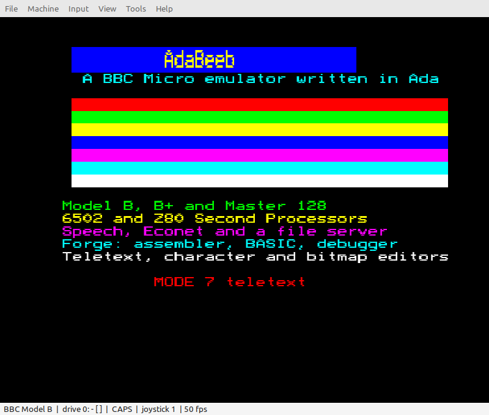
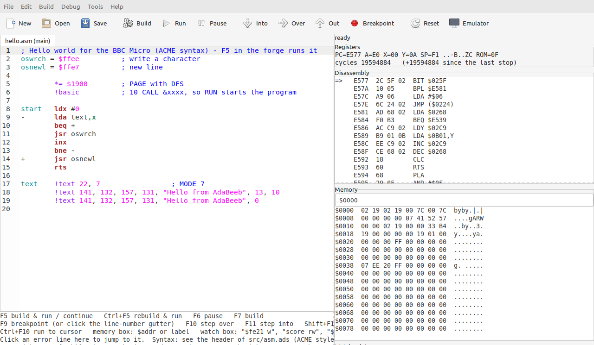
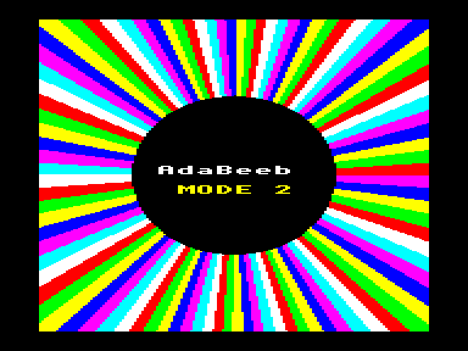
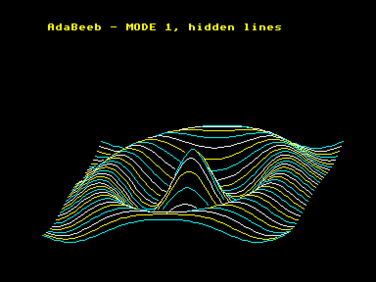
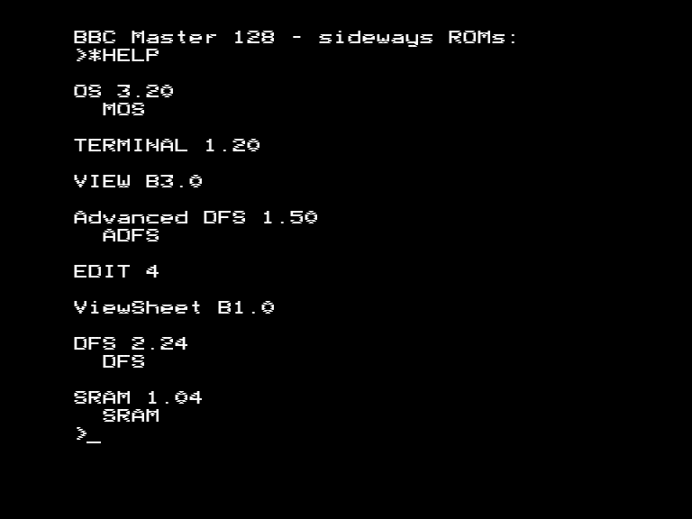
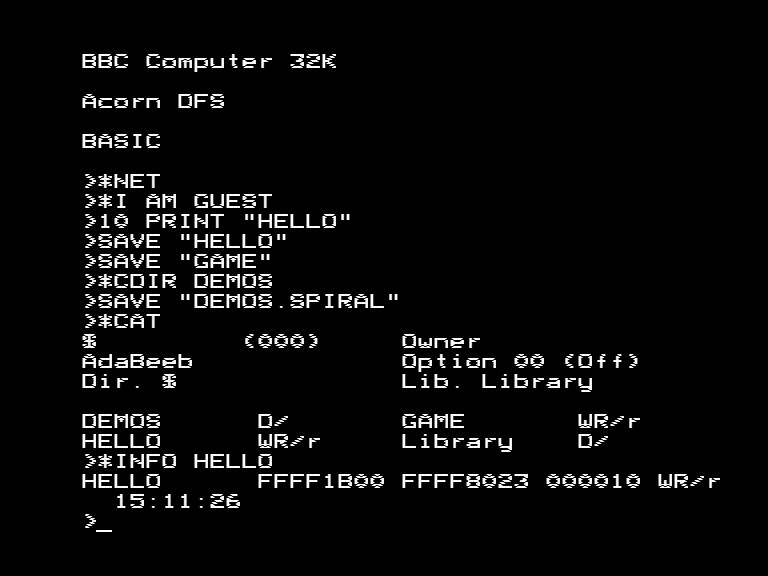
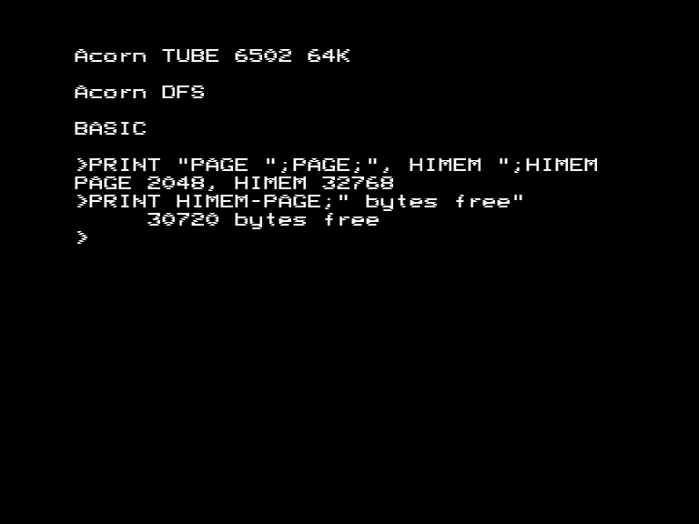
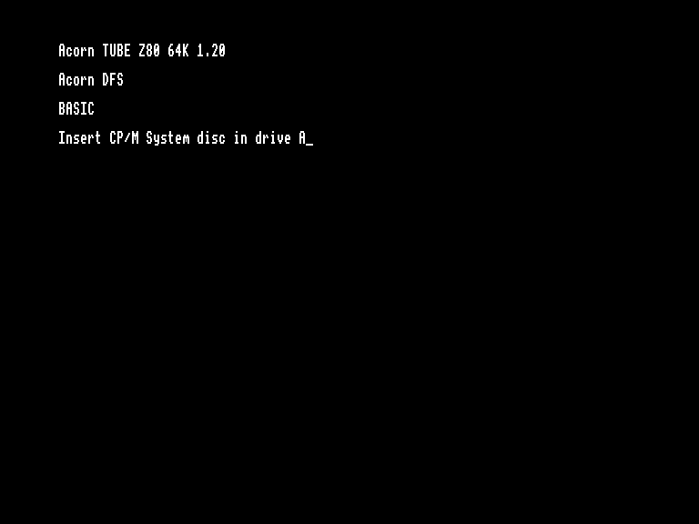

# AdaBeeb

A BBC Micro (Model B, Model B+ and Master 128) emulator written in Ada 2012 with
GtkAda, with **Forge**: a 6502 assembler IDE, BBC BASIC editor,
source-level debugger and graphics editors around the running machine.
It is the BBC sibling of AdaC64 (`../c64`).

## Screenshots

<table>
<tr>
<td> The emulator window (mode 7 teletext)</td>
<td> Forge: assembler, debugger and memory view</td>
</tr>
<tr>
<td> MODE 2 graphics from BBC BASIC</td>
<td> MODE 1 hidden-line plot</td>
</tr>
<tr>
<td> BBC Master 128 and its ROMs</td>
<td> Econet: NFS and the built-in file server</td>
</tr>
<tr>
<td> BASIC on the 6502 Second Processor</td>
<td> The Z80 Second Processor waiting for CP/M</td>
</tr>
</table>

The emulated screens are made by `docs/screenshots/make.sh` from the
BASIC programs in `docs/screenshots/src/`.

## Build and run

    make                     # GNAT, gprbuild, GtkAda, libpulse-dev, zlib,
                             # libgtksourceview-4 (Forge's editor)
    bin/adabeeb              # Model B (or the model used last time)
    bin/adabeeb --master     # BBC Master 128
    bin/adabeeb --bplus      # BBC Model B+ (64K, shadow RAM, 1770)
    bin/adabeeb --tube       # with a 6502 Second Processor
    bin/adabeeb --z80        # with a Z80 Second Processor
    bin/adabeeb --econet 5   # Econet station 5 with the built-in file server
    bin/adabeeb --speech     # with the speech upgrade (Model B / B+)
    bin/adabeeb game.ssd     # autostart (also .dsd .adf .adl .uef .bas .asm)
    bin/adabeeb-forge        # Forge as the main window
    make tests               # CPU, debugger, bitmap/ULA and BASIC tests
    make z80tests            # ZEXDOC / ZEXALL on the Z80 core
    make b2tests             # b2's real-hardware VIA / timing tests (slow)

Discs boot with SHIFT+BREAK when they have a boot option, otherwise the
first file is `CHAIN`ed (BASIC) or `*RUN`; tapes get `*TAPE` and
`CHAIN""` / `*RUN`; `.bas` files are tokenised and RUN, `.asm` files
assembled and started (RUN through a `!basic` stub, else `CALL &start`).

Options: `--roms DIR`, `--rom N=FILE` (sideways ROM in slot N),
`--econet-dir DIR` (the file server's folder),
`--swram N`, `--links HEX` (start-up links), `--attach FILE`, and for
testing `--headless N` (run N frames, save `shot.png`), `--png FILE`,
`--type TEXT` (typed at the BASIC prompt, `\n` = RETURN),
`--type-at FRAME TEXT`, `--screen` (print the screen as text),
`--wav FILE`, `--dump FILE` (32 KB RAM), `--save-tape FILE`,
`--load-snapshot FILE` / `--save-snapshot FILE` (before / after the run).
Command-line tools: `--basic SRC` (tokenise), `--list FILE`,
`--asm SRC`.

## ROMs

AdaBeeb contains no Acorn software. Like the real machine it needs the
original system ROMs, which are still copyrighted by their owners. Use
images you are entitled to use: dumps read out of your own BBC Micro or
Master (an EPROM reader, or `*SAVE` of the ROM area from a running
machine), or copies from a source that is licensed to distribute them.
Do not pass the ROM files on together with AdaBeeb.

Put the files in the `roms/` directory next to `bin/` (or point to
another directory with `--roms DIR`). The names and sizes must be exactly
these:

| File | Size | Contents | Needed for |
|------|------|----------|------------|
| `os12.rom` | 16 KB | Acorn MOS 1.20 (the Model B operating system, &C000-&FFFF) | Model B (required) |
| `basic2.rom` | 16 KB | BBC BASIC II, loaded into sideways slot 15 | Model B (without it the machine starts without a language) |
| `dnfs120.rom` | 16 KB | Acorn DNFS 1.20 (DFS 1.20 for the 8271 disc controller), slot 14 | Model B discs (without it: tape only, PAGE = &E00) |
| `bpos.rom` | 16 KB | Acorn OS 2.00 for the Model B+ | Model B+ (required) |
| `dfs226.rom` | 16 KB | Acorn 1770 DFS, slot 14 on the B+ | Model B+ discs |
| `mos320.rom` | 128 KB | Master 128 MOS 3.20: the 16 KB MOS followed by the seven internal ROMs for slots 9-15 (DFS, ADFS, BASIC IV, View, ...) in that order | Master 128 (required) |
| `6502tube.rom` | 2 KB | The 6502 Second Processor's Tube client ROM (Acorn's 6502 Tube client OS) | only with the Second Processor (`--tube`) |
| `z80tube.rom` | 4 KB | The Z80 Second Processor's client ROM (Acorn, version 1.20) | only with the Z80 Second Processor (`--z80`) |
| `phroma.rom` | 16 KB | Acorn's speech PHROM A (the word ROM of the BBC speech upgrade, a TMS6100 dump) | only with speech (`--speech`) |
| `saa5050.fnt` | 46 KB | SAA5050 teletext character shapes in the B-Em "BEMTTX01" font format | optional: without it mode 7 is drawn with characters made from the OS font |

The files are searched for in this order: the `--roms` directory,
`roms/` next to the program, `roms/` and `../roms/` in the current
directory, `/usr/share/adabeeb/roms/`. If `os12.rom` or `mos320.rom` is
missing, AdaBeeb says so when it starts.

Notes:

* The DFS must be one for the **8271** (DFS 0.90, 1.20, DNFS). DFS 2.x is
  the Master's 1770 version and does not work in a Model B.
* More sideways ROMs (16 KB images) go in with Machine -> Sideways ROMs
  and RAM (a ROM file, RAM or empty per slot, remembered per model) or
  `--rom N=FILE` / `--swram N` on the command line. Slots 4-7 are
  sideways RAM by default on the Model B (switchable) and the Master.
* The Master keeps its configuration (`*CONFIGURE`) and clock in CMOS
  RAM, stored in `~/.config/adabeeb/cmos.bin`; delete that file to get
  the defaults back (DFS and BASIC, MODE 7).
* The same goes for software: the disc and tape images in `discs/` used
  for testing (Acorn's Welcome disc and tape, the B-Em demo disc) are
  third-party software and are not part of AdaBeeb.
* Klaus Dormann's 6502 / 65C02 test binaries in `tests/` are not ROMs;
  they are free test programs used by `make tests`.

## What is emulated

| Part | Notes |
|------|-------|
| 6502 / 65SC12 | All documented and the stable undocumented NMOS opcodes, decimal mode, exact cycle counts; CMOS mode for the Master (BRA, PHX/PLY, STZ, TRB/TSB, (zp), JMP (abs,X), defined NOPs, Rockwell bit ops as an option). Passes Klaus Dormann's 6502 functional and 65C02 extended tests. |
| 1 MHz bus | CPU clock stretching on accesses to the 1 MHz devices. |
| 6845 CRTC + video ULA | Emulated per character clock: all modes, palette and mode changes mid-line and mid-frame (splits), hardware scrolling with screen-size wrap, cursor with skew and ULA segments, flashing colours, interlace sync & video. |
| SAA5050 | Mode 7 with the real character shapes: mosaics (contiguous / separated), hold graphics, double height, flash, conceal, backgrounds. |
| SN76489 | 3 tones + noise (white / periodic), volume-register sample playback; PulseAudio output paces the emulation. |
| 2 x 6522 VIA | Timers per 1 MHz cycle with the real load / reload / one-shot rules, PB7 output, T2 pulse counting, IRQ output timing; passes 23 of the 24 b2 VIA and timing tests recorded on a real BBC (in VTIMEOU an interrupt handler's timer read lands one 1 MHz cycle early in half the cases). System VIA (keyboard auto-scan, addressable latch, VSYNC, ADC end of conversion, CMOS clock on the Master) and user VIA. |
| Keyboard | Full matrix, start-up links, BREAK / SHIFT+BREAK / CTRL+BREAK; Master numeric keypad. |
| 8271 FDC | Model B: commands used by DFS (read/write/verify/format/seek/read ID/special registers), byte-timed NMIs. |
| WD1770 | Master: drive control latch at &FE24, type I-IV commands. |
| Discs | SSD / DSD (DFS) and ADF / ADL (ADFS, double density) images, two drives, written back after every write; read-only files are write-protected discs. |
| Tape | UEF (gzip or plain) through the 6850 ACIA and serial ULA, motor control, warp while the motor runs; what is SAVEd to tape can be stored as a UEF. |
| ADC | uPD7002, joystick from the keypad or a host game controller, fire buttons. |
| Model B+ | 64K: 20K shadow RAM (ACCCON bit 7, MODE 128-135), 12K private RAM, 1770 at &FE80, OS 2.00. |
| Tube | 6502 Second Processor: Tube ULA (R1 24-byte FIFO, R2, R3 one or two bytes, R4, control flags, interrupts) and a 65C02 at 3 MHz with 64 KB RAM. On with `--tube` or Machine -> 6502 Second Processor (Tube), on all three models: BASIC runs in the parasite with PAGE = &800, HIMEM = &8000. Saved in snapshots; the debugger works on either processor. |
| Z80 Second Processor | A Z80 at 6 MHz with 64 KB RAM on the same Tube: the client ROM at &0000 after reset and for NMIs, paged out by fetches from &8000 up; the Tube registers on I/O ports 0-7; mode 2 interrupts. Boots to "Acorn TUBE Z80 64K" and asks for the CP/M system disc, as the real one does (CP/M is not included). The Z80 core passes ZEXDOC and ZEXALL. On with `--z80` or the Machine menu; saved in snapshots. |
| Econet | Model B: the MC6854 ADLC at &FEA0 (status and prioritised status, FIFOs, interrupts to NMI through INTON / INTOFF at &FE20 / &FE18), the station number at &FE18, and the network a message at a time as AUN does (the four-way handshake is answered locally). A file server is built in as station 254; other AdaBeeb instances on this computer are other stations. Use the NFS in DNFS 1.20. See below. |
| Speech | The speech upgrade on the Model B / B+: TMS5220 (commands, status, speak from PHROM, speak external through the FIFO) with LPC synthesis at 8 kHz from the chip's measured coefficient tables, and PHROM A. `SOUND -1,word,0,0` speaks word numbers 128 onwards. On with `--speech` or the Machine menu. |
| Master 128 | 128 KB: shadow RAM (LYNNE), ANDY, HAZEL, sideways RAM 4-7, ACCCON / ROMSEL, CMOS RAM and real-time clock (kept in `~/.config/adabeeb/cmos.bin`). |

Snapshots (Machine menu, Alt+S / Alt+L quick save/load) hold the whole
machine; the monitor (Alt+M) has registers, disassembly, memory,
breakpoints, watchpoints and stepping.

With the 6502 Second Processor, BASIC and the programs Forge or
autostart load run in the parasite, so the debugger starts out on the
Second Processor: breakpoints, watchpoints, stepping, registers and
memory are its own, and BASIC line breakpoints follow BASIC there.
`host` / `tube` in the monitor (`cpu` shows which) and Debug -> Switch
processor in Forge change that. Code that pokes the screen directly
must run on the host (as on a real machine).

## Econet

Turn Econet on with `--econet N` (station N, default 1) or Machine ->
Econet; it is fitted to the Model B, whose DNFS ROM contains the network
filing system. Select the network with `*NET` (or N+BREAK), then log on
to the file server with `*I AM name` (any name; no passwords):

    *NET
    *I AM GUEST
    SAVE "PROG"          LOAD "PROG"          CHAIN "PROG"
    *CAT    *EX    *INFO PROG    *CDIR GAMES    *DIR GAMES    *DIR ^
    *DELETE PROG    *RENAME A B    *RUN CODE    *HELLO (runs file HELLO)

The file server (station 254) serves the folder given by `--econet-dir`
(default `~/.config/adabeeb/econet`, created when first used). Files are
ordinary host files; their load and execution addresses are kept in
`NAME.inf` beside them, so you can copy programs in and out. A directory
called `Library` is the library. OPENIN / OPENOUT / OPENUP, BGET#, BPUT#,
PRINT#, INPUT#, PTR#, EXT# and EOF# work on files on the server.

Several AdaBeeb instances on the same computer form one network: start
each with its own station number (`--econet 5`, `--econet 6`, ...). They
reach each other over UDP on 127.0.0.1, port 32768 + station, with AUN's
packet format, so programs can use OSWORD &10 / &11 to send messages.
The network does not reach other computers. Because the handshake is
answered locally, sending to a station that is not running reports "Net
error" rather than "Not listening", and immediate operations (remote
peek / poke, *VIEW, *REMOTE) are not answered.

## Keys

Symbolic mapping by default (type the character you mean; Input menu:
positional). F1-F9 = f1-f9, F10 = f0, F12 / Pause = BREAK, End / Insert /
Home = COPY, Caps Lock = CAPS LOCK, Page Up = SHIFT LOCK, ` = £.
Emulator: F11 warp, Alt+Enter fullscreen, Alt+A autostart, Alt+D insert
disc, Alt+B boot the disc in drive 0 (SHIFT+BREAK), Alt+R power-on reset, Alt+M monitor, Alt+S / Alt+L quick snapshot,
Ctrl+Shift+V paste text.

## Forge

Assembler (ACME syntax, see `src/asm.ads`; programs default to `*= $1900`,
`!basic` makes a `10 CALL &xxxx` line), BBC BASIC tab (Ctrl+Shift+N; the
tokeniser produces exactly the ROM's bytes, the running line is
highlighted, F9 / gutter clicks set breakpoints on BASIC lines and
F10 / F11 step one BASIC line at a time when stopped), debugger (F5 run / continue, F9 breakpoint, F10 / F11 /
Shift+F11 step, Ctrl+F10 run to cursor, watchpoints, memory and
disassembly panels), and Build -> disc image: a `.disc` file lists the
files, an `.ssd` with a `!BOOT` is written and can be booted directly.

Tools:

* **Teletext editor** (Ctrl+R, `.m7`): 40 x 25 mode 7 screens, text typed
  in, control codes from a palette, sixel graphics drawn with the mouse,
  shown exactly as the SAA5050 renders them; export as BASIC or ACME,
  show / live / grab with the emulator.
* **Character editor** (Ctrl+K, `.udg`): VDU 23 characters 32-255 from
  the OS font; export as VDU 23 lines or ACME, live in the running OS's
  font memory (*FX20 for the lower codes).
* **Bitmap editor** (Ctrl+B, `.bbm`): modes 0, 1, 2, 4, 5 with their
  palettes (VDU 19), pencil / line / rectangle / ellipse / fill / pick,
  PNG import with dithering, screen dump + BASIC loader or ACME export,
  show / live / grab with the emulator.

## Source layout

    src/mos6502.*      6502 / 65SC12 core       src/via.*       6522 VIA
    src/display.*      6845 CRTC, video ULA, SAA5050 (per character clock)
    src/teletext_font.* SAA5050 shapes           src/sound.*     SN76489
    src/machine.*      memory maps, paging, I/O, run loop, debugger
    src/keyboard.*     matrix and host keys     src/tape.*      UEF, ACIA
    src/fdc8271.*      8271                     src/wd1770.*    WD1770
    src/disc_image.*   SSD / DSD, catalogue     src/gui.*       GtkAda
    src/tube.*         Tube ULA + 6502 Second Processor
    src/z80.*          Z80 core
    src/econet.*       ADLC, AUN-style network    src/econet-file_server.* file server
    src/speech.*       TMS5220 speech chip, PHROMs, LPC synthesis
    src/rom_dialog.*   sideways ROM / RAM slots dialog
    src/monitor*.*     machine-code monitor     src/disasm.*    disassembler
    src/asm.*          assembler                src/basic.*     BBC BASIC
    src/forge.*        Forge window             src/source_view.* editor
    src/teletext_*     teletext editor          src/char_*      VDU 23 editor
    src/bitmap_*       bitmap editor            src/editor_util.* helpers
    tests/             CPU (Klaus Dormann), debugger, bitmap/ULA and
                       BASIC-against-the-ROM tests; tests/b2/ holds test
                       programs from the b2 emulator (GPL v3) with output
                       and images recorded on real machines
    tests/z80/         ZEXDOC / ZEXALL (Frank D. Cringle, GPL) for z80tests
    examples/hello.asm
